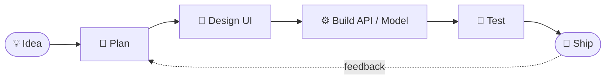

<!-- ═══════════════════════ HERO ═══════════════════════ -->
<div align="center">


<br>

<a href="https://github.com/ArsalJan34"></a>
<a href="https://www.linkedin.com/in/arsal-chandio-b2003a347"></a>


</div>

<br>

<!-- ═══════════════════════ ABOUT ═══════════════════════ -->
<h2 align="center">⟡ &nbsp;Who I Am&nbsp; ⟡</h2>

<p align="center">
I design and build software end to end, from the interface a person clicks<br>
to the model running quietly behind it. I like small, sharp tools,<br>
clean code, and finishing what I start.
</p>

<div align="center">

| 🎯 **Focus** | 🌱 **Learning** | ⚡ **Style** |
| :---: | :---: | :---: |
| Full-stack web + practical ML | PyTorch · system design · cloud | Ship early, refine often |

</div>

```python
# arsal.py
class Arsal:
    role     = "Frontend Developer · ML Enthusiast"
    stack    = ["React", "Node.js", "Python", "PyTorch"]
    mindset  = ["clarity", "consistency", "ship > perfect"]
    status   = "open to collaborations"

    def build(self, idea):
        return self.design(idea) | self.code(idea) | self.ship(idea)
```

<br>

<!-- ═══════════════════════ RIGHT NOW ═══════════════════════ -->
<h2 align="center">⟡ &nbsp;Right Now&nbsp; ⟡</h2>

<div align="center">

| | |
| :-- | :-- |
| 🔭 **Working on** | Full-stack projects that combine React with ML-powered features |
| 📚 **Studying** | Neural networks in PyTorch, data structures, backend architecture |
| 🤝 **Looking for** | Teammates, open-source projects, internship opportunities |
| 💬 **Ask me about** | React, Python, data analysis, getting started with ML |

</div>

<br>

<!-- ═══════════════════════ SKILLS ═══════════════════════ -->
<h2 align="center">⟡ &nbsp;Tech Arsenal&nbsp; ⟡</h2>

<div align="center">

**Languages**<br>


**Frontend & Backend**<br>


**Machine Learning & Data**<br>


**Databases & Cloud**<br>


**Tools**<br>


</div>

<details>
<summary><b>▸ Also in my toolbox</b></summary>
<br>
<div align="center">


</div>
</details>

<br>

<!-- ═══════════════════════ HOW I WORK ═══════════════════════ -->
<h2 align="center">⟡ &nbsp;How I Build&nbsp; ⟡</h2>



<br>

<!-- ═══════════════════════ PROJECTS ═══════════════════════ -->
<h2 align="center">⟡ &nbsp;Featured Projects&nbsp; ⟡</h2>

<p align="center"><sub>🔧 Replace the placeholders with your real repositories</sub></p>

<details open>
<summary><b>🌐 Web & Full-Stack</b></summary>
<br>

<table>
  <tr>
    <td width="50%" valign="top">
      <h3>◆ Project One</h3>
      <p>One clear sentence: what it does and who it helps.</p>
      
      
      
      <br><br>
      <a href="https://github.com/ArsalJan34/REPO-NAME"><b>Code</b></a> &nbsp;·&nbsp; <a href="#"><b>Live demo</b></a>
    </td>
    <td width="50%" valign="top">
      <h3>◆ Project Two</h3>
      <p>One clear sentence: what it does and who it helps.</p>
      
      
      
      <br><br>
      <a href="https://github.com/ArsalJan34/REPO-NAME"><b>Code</b></a> &nbsp;·&nbsp; <a href="#"><b>Live demo</b></a>
    </td>
  </tr>
</table>

</details>

<details>
<summary><b>🧠 Machine Learning</b></summary>
<br>

<table>
  <tr>
    <td width="50%" valign="top">
      <h3>◆ Project Three</h3>
      <p>Model goal, dataset, and the result you achieved.</p>
      
      
      <br><br>
      <a href="https://github.com/ArsalJan34/REPO-NAME"><b>Code</b></a> &nbsp;·&nbsp; <a href="#"><b>Notebook</b></a>
    </td>
    <td width="50%" valign="top">
      <h3>◆ Project Four</h3>
      <p>Model goal, dataset, and the result you achieved.</p>
      
      
      <br><br>
      <a href="https://github.com/ArsalJan34/REPO-NAME"><b>Code</b></a> &nbsp;·&nbsp; <a href="#"><b>Notebook</b></a>
    </td>
  </tr>
</table>

</details>

<br>

<!-- ═══════════════════════ STATS ═══════════════════════ -->
<h2 align="center">⟡ &nbsp;GitHub Pulse&nbsp; ⟡</h2>

<div align="center">


</div>

<br>

<!-- ═══════════════════════ SNAKE ═══════════════════════ -->
<div align="center">

<picture>
  <source media="(prefers-color-scheme: dark)" srcset="https://raw.githubusercontent.com/ArsalJan34/ArsalJan34/output/github-snake-dark.svg" />
  <source media="(prefers-color-scheme: light)" srcset="https://raw.githubusercontent.com/ArsalJan34/ArsalJan34/output/github-snake.svg" />
  
</picture>

</div>

<br>

<!-- ═══════════════════════ CONNECT ═══════════════════════ -->
<h2 align="center">⟡ &nbsp;Let's Connect&nbsp; ⟡</h2>

<div align="center">

<a href="https://www.linkedin.com/in/arsal-chandio-b2003a347"></a>
&nbsp;&nbsp;&nbsp;
<a href="https://github.com/ArsalJan34"></a>

<br><br>


</div>


